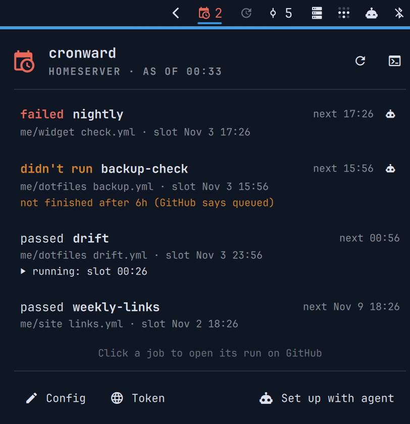

<h1 align="center">cronward</h1>

<p align="center">Whether the GitHub Actions workflows <a href="https://github.com/Frestina/cronward">cronward</a> starts on a schedule passed, failed or didn't run, in your Omarchy bar.</p>

<p align="center"><a href="https://github.com/tcballard/omarchy-badges"></a></p>

<p align="center"></p>

[cronward](https://github.com/Frestina/cronward) starts your workflows
from a Linux machine you own, follows each run, and keeps three answers
apart: passed, failed, and didn't run. This widget shows those answers.

GitHub Actions widgets that read the runs straight from GitHub show the last
green run even when a scheduled one never started. This one shows cronward's
own results, so a slot that was missed, refused or never finished shows as
didn't run, never as fine. It holds no token and makes no network calls of
its own: on the machine that runs cronward it reads `cronward status`, and
on a laptop it reads the status that cronward's viewer last fetched from
that machine.

- **The bar icon** is dim while every job's latest result passed and the
  main machine is ticking. It turns red with a count when a job failed, and
  orange with a count when one didn't run, the main machine stopped ticking
  or can't be reached, a tick failed, or a token is missing or expires
  soon. A dot beside it means a run is going.
- **Left-click:** each job with its result, repo and workflow, why it didn't
  run, and its next slot. Click a job to open its run on GitHub.
- **Middle-click** (or <kbd>r</kbd> in the popup): check now. On a laptop
  that fetches the status from the main machine (`cronward watch`).
- **Right-click:** `cronward status` in a terminal.

The widget gives no notices of its own: cronward and its viewer already do.

## Ask your agent

A job that failed or didn't run has an agent button. It starts your default
coding agent (`omarchy agent`; pick one in the Omarchy menu if you haven't)
with the job and [a guide to explaining it](docs/AGENT_EXPLAIN.md): it reads
the run's log or the reason cronward gave, says what happened and what you
could do, and changes nothing without asking.

**Set up with agent**, at the bottom of the popup, has it put a new workflow
on cronward with you, following [a setup guide](docs/AGENT_SETUP.md) and
cronward's own skill: it finds the repo's clone, adds `workflow_dispatch:`,
adds the job, tests it with a real run after asking, and takes out the
workflow's `schedule:`. Omarchy starts agents with their approval prompts
switched off, so the guides keep the agent away from your tokens and have it
ask before a test run or a push.

## Requirements

- Omarchy 4.
- cronward with `status --host` and `--on`: its `main` branch from
  2026-11-04, or the first release after v0.1.0.
  - On the machine that runs cronward: nothing else.
  - On a laptop: cronward installed as a viewer of the main machine
    (`cronward install --viewer homeserver`). For the buttons that change
    something there (Config, storing a token, Set up with agent), an ssh
    login to it that can run commands, as `cronward --on` needs.

## Install

```bash
omarchy plugin add https://github.com/Frestina/cronward-omarchy --enable
```

On a laptop, set the widget's **Main machine** to the main machine, as you
would type it after `ssh` (the same as for `cronward install --viewer`).
Leave it blank on the machine that runs cronward.

| Setting | Default | |
| --- | --- | --- |
| `host` (Main machine) | blank | Blank: cronward runs here. Otherwise the main machine; the widget reads the status this machine's viewer fetched from it. |
| `cronward` (cronward command) | `cronward` | The command or its full path. The default also finds `~/.local/bin/cronward`, as the shell's `PATH` may lack it. |
| `refreshSec` | 60 | How often it reads the status: a local, cheap command. On a laptop the viewer fetches a new copy hourly, and Check now fetches one at once. |

## The buttons

Every button runs cronward, a terminal, your coding agent, or `xdg-open`
on a github.com page. On a laptop, what changes something runs on the main
machine through `cronward --on <host>`.

- **Config**: the config in your editor, in a terminal (`cronward edit`).
- **Token**: GitHub's fine-grained token page, to give a token access to
  another repo.
- **The key** next to a missing or expiring token: a terminal running
  `cronward token set <account>`. You type the token there; the widget never
  sees it.
- **Check now** and **the terminal**: as middle and right click.

## What it shows

| Popup header | Meaning |
| --- | --- |
| `HOMESERVER · LAST TICK 13:06` | This machine runs cronward. |
| `HOMESERVER · AS OF 13:08` | A laptop: the status as its viewer last fetched it. |
| `cannot reach homeserver since 14:10: ...` | The last fetch failed since then. Orange. |
| `stopped ticking: last tick 13:01` | The main machine's last tick was over 30 minutes old. Orange. |
| `a tick failed: ...` | cronward's last tick ended in an error. Orange. |
| `this machine is offline` | This laptop had no network at the last fetch. Not a problem with the main machine. |
| `cronward not found`, `not set up`, `status failed` | cronward isn't installed here, has no config (or no fetched status yet), or answered with an error. Never shown as fine. |

## Update

```bash
omarchy plugin update io.github.frestina.cronward
omarchy restart shell
```

## Remove

```bash
omarchy plugin remove io.github.frestina.cronward
```

The widget keeps no files, so there is nothing else to clean up. cronward
and its data are untouched.

## Development

Requires Node.js 22. Run the checks from the repository root:

```bash
./tests/run
```

`CronwardView.js` turns cronward's status into what the widget shows, and
its tests run it against `demo/fixtures`, one status per state.
`demo/run "<x>,<y> <w>x<h>" [STATE...]` shows those states in the installed
widget, through a fake `cronward`, and captures them.

[Develop and test](docs/DEVELOPMENT.md) · [Architecture](ARCHITECTURE.md) · [Release process](docs/RELEASE.md)

## Compatibility

Tested on Omarchy 4.0.6 with Hyprland 0.56 and Quickshell 0.3.2. Details in
[acceptance evidence](docs/ACCEPTANCE.json).

## Credits

Built from [Build Omarchy Plugins](https://github.com/tcballard/build-omarchy-plugins) guidance and the Omarchy template set, and shaped like [Fleetwatch](https://github.com/Frestina/fleetwatch). [Sources and assets](CREDITS.md).

## Licence

[MIT](LICENSE). Third-party software and media retain their own licences.
